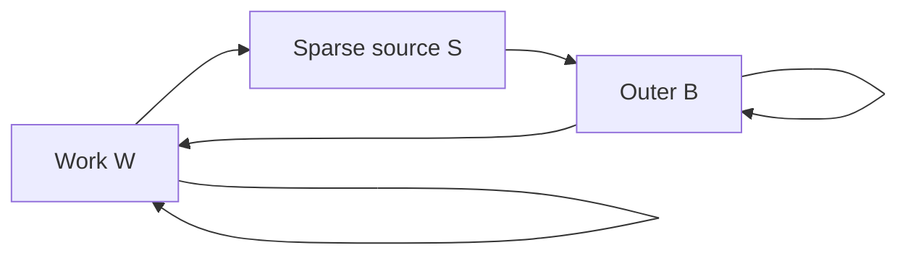

# Executable public-refresh publication inventory

The research circuit now carries a `KeyGraphCertificate` derived from its
validated plan. Setup counts the actual generated raw/transformed key rows
and refuses to return an evaluator if any role differs from the planned
inventory. Transform caches are not additional encryption samples.

For the native plan the counts are:

| Published role | Message secret → encryption secret | Ciphertexts |
| --- | --- | ---: |
| Work public key | zero → W | 1 |
| Work relinearization | W² → W | 12 |
| Source switch | embedded W → S | 20 |
| Coherent phase bank, p² and p | shifted S → B | 256 |
| Outer relinearization | B² → B | 66 |
| Phase and inverse automorphism keys | sigma(B) → B | 264 |
| Original-work-key return | reduced B → embedded W | 40 |
| **Total** | | **659** |

The graph has both a three-domain cycle and self-key dependencies:



`requires_circular_security()` computes reachability from the actual relation
inventory. Regressions separately remove the return edge or the self edges:
either modification by itself leaves cyclic dependencies. This prevents
describing a return-key rotation alone as an acyclic construction.

The domain records expose ordered primes, actual ring degrees, plaintext
trays, CBD eta, and secret-distribution descriptions. The embedded return
secret's effective degree is **8192**, not 32768. Its 40 outer-ring samples
decompose into four degree-8192 channels each sharing the work secret; a
review must account for those channels rather than crediting a dense outer
secret distribution.

The SHA-256 fingerprint binds the ordered work/source/outer parameters,
source weight, gadget/baby schedule, relation counts, and hashes of the
included generator/sampler implementation files. It is a reproducibility
identifier, not cryptographic authentication of remote execution. It is not
the existing per-key-family identity, which remains separately checked.
Changing numeric parameters, key generation, or ordered CRT layout requires
matching new evidence. This is a source-bound fingerprint of the enumerated
files, not a complete build attestation or an audit of every dependency and
feature combination. The research API can accept explicitly insecure RNGs;
the inventory does not certify the RNG used by a particular execution.

## Reproduction

The existing example now has a key-free inspection mode:

```sh
cargo run --locked -p nine65 --features allow_insecure \
  --example public_refresh_circuit -- --describe
```

It prints the native preflight, exact key graph, domain parameters, hex
fingerprint, circular-security requirement, and return effective dimension,
then exits before generating keys. Unknown arguments fail before key setup.
It also reruns the work/outer factorization-aware engineering screens directly
from those domain parameters and explicitly excludes the sparse source from
the dense-secret screen. These screening figures are not joint-key proofs.
Omitting `--describe` retains the expensive five-cycle native research run.

Three exact regressions under
`ops::public_refresh_circuit::key_graph::tests` cover sample-count mismatches,
tuple/order/schedule binding, and independent cycle obligations. Existing
encrypted circuit tests exercise the generated-count check during actual
setup. These tests are registered in the refresh research gate runner.

## Remaining evidence

The previous external sparse-source results and deterministic Q650 screen
remain evidence for their stated attack models. They are not joint/KDM
reductions for this graph. The new inventory grants no production security
status, makes no quantum-security claim, and cannot fill missing Hou/Jiang
attack coverage. No specialist acceptance or new external-estimator run is
claimed here. The current environment has no cached Sage estimator image.

The owner selected canonical plaintext m as the native root quantity. The
[implemented canonical-root binding](CANONICAL_PLAINTEXT_ROOT.md) uses the
actual sealed work/source/return producers, independently of this inventory.
It does not manufacture root authority from K or a matching lineage tag.
