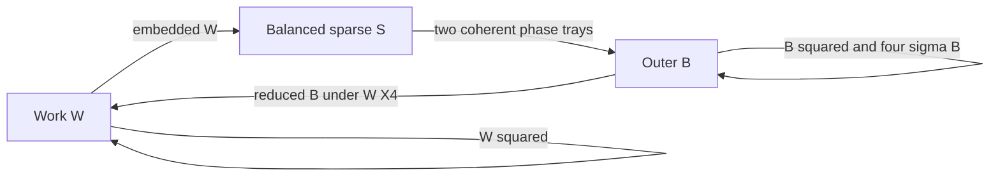

# Public-refresh key graph: current-source bounded evidence

Source: `7ada6503634a824e80bc4bcfd6231ad0178d7ed3`, branch `work`.
Execution date: 2026-11-10 UTC. Scope: the explicit research API
`ops::public_refresh_circuit::PublicRefreshCircuitPlan`, under
`allow_insecure`; legacy/default `ops::bootstrap` is a different path.

The current-source key-free export and independent fingerprint recomputation
agree on **659 published RLWE ciphertext rows**. Read-only generator review
found no mismatch with the seven aggregate certificate roles. This evidence
makes the messages, four Galois exponents, embedded-return channels and
correlations explicit. It does not discharge the joint-setup security premise.
Confidentiality of the related-key setup remains unestablished, and production
admission remains closed.

Current interpretation follows [public-refresh status](../../PUBLIC_REFRESH_STATUS.md),
the [security pack](../../security/README.md), the existing
[key graph](../2026-10-31/PUBLIC_REFRESH_KEY_GRAPH.md) and
[conditional reduction](../2026-10-31/PUBLIC_REFRESH_SECURITY_REDUCTION.md).
The parallel [parameter/distribution evidence](PARAMETER_DISTRIBUTION_EVIDENCE.md)
records the broader profile and sampler packet.
No historical log, hash or measured result was changed. All new results below
belong to the stated source, independently of older native executions.

## Exact domains and distributions

Let `p=65537`. Work and source use plaintext modulus `p`; the outer ring has
two contexts at plaintext moduli `p` and `p²=4295098369`, sharing the same
outer secret and ordered ciphertext primes. All three native domains have
`eta=3` and `security_bits=0`.

| Domain | Ring | Ordered ciphertext primes | Product bit length | Secret law under ideal independent secure words |
| --- | --- | --- | ---: | --- |
| Work `W` | `Z_Q[X]/(X^8192+1)` | `998244353, 985661441, 754974721, 469762049` | 119 | Independently apply `next_u64()%3`: residues `0→0`, `1→+1`, `2→-1` |
| Source `S` | `Z_Q[X]/(X^8192+1)` | `998244353, 985661441` | 60 | Exactly 48 positive and 48 negative coefficients on distinct hidden positions; all other coefficients zero |
| Outer `B` | `Z_Q[X]/(X^32768+1)` | Work primes followed by the nine primes below | 650 | `FheRng::ternary_vector`; with `SecureRng`, rejection sampling gives each of `-1,0,+1` probability `1/3` |
| Return receiver | Outer-size ring at the **work** prime product | Work primes | 119 | `W(X⁴)`: 8192 sampled work coordinates, 24576 prescribed zero positions; effective secret degree 8192 |

The additional outer primes, in order, are
`576460752301785089, 576460752301391873, 576460752300015617,
576460752298835969, 576460752298180609, 576460752293134337,
576460752291954689, 576460752290775041, 575870995836829697`.
Work prime widths are `[30,30,30,29]`, source widths `[30,30]`, and each
additional outer prime has 59 bits. Exact products and source hashes are in
the [source-bound machine-readable audit](../../../artifacts/execution/2026-11-10/public-key-graph/key_graph_audit.source-bound.json).

The work sampler is **not exactly uniform ternary**. Write
`2^64=3k+1`. Its probabilities are `P(W_i=0)=(k+1)/2^64` and
`P(W_i=+1)=P(W_i=-1)=k/2^64`. This small deviation must be accounted for
when ideal ternary distributions are used in a concrete model. The source
sampler selects uniformly from unoccupied indices by masking a full word
with `8191` and rejecting duplicates. The first 48 accepted positions receive
`+1`, the last 48 receive `-1`. Thus, under ideal uniform words, it is uniform
over `C(8192,96) C(96,48)` signed supports. Its coordinates are dependent:
the weight is fixed at 96 and the coefficient sum is exactly zero. It is not
independent ternary at density `96/8192` and is not an unrestricted fixed-weight
sign distribution. These laws follow directly from
[`rns_fhe.rs:1677`](../../../crates/nine65/src/ops/rns_fhe.rs#L1677),
[`public_refresh_source_kernels.rs:43`](../../../crates/nine65/src/ops/public_refresh_source_kernels.rs#L43),
[`rng_trait.rs:52`](../../../crates/nine65/src/entropy/rng_trait.rs#L52) and
[`secure.rs:278`](../../../crates/nine65/src/entropy/secure.rs#L278).

Work public-key and all hybrid-gadget errors use `sample_cbd_signed_rng`:
three differences of independent low bits drawn from six words. Phase-bank
errors use `rng.cbd_vector`; `SecureRng::cbd` uses three words, each supplying
two different bits. Under ideal uniform secure words both have the exact
CBD(3) law on `[-3,3]`, with probabilities
`[1,6,15,20,15,6,1]/64`, variance `3/2`, and standard deviation
`sqrt(3/2)`. This is a bounded binomial law, not a discrete Gaussian.
In each ciphertext one signed error vector is encoded coherently into all
CRT lanes; those lanes are not separately sampled errors.
See [`rns_fhe.rs:6572`](../../../crates/nine65/src/ops/rns_fhe.rs#L6572),
[`exact_mul.rs:1124`](../../../crates/nine65/src/ops/exact_mul.rs#L1124),
[`direct_slot_phase.rs:338`](../../../crates/nine65/src/ops/direct_slot_phase.rs#L338),
and [`secure.rs:300`](../../../crates/nine65/src/entropy/secure.rs#L300).

Masks are sampled per CRT lane with the RNG's unbiased bounded sampler;
under ideal secure words this is uniform in the full product ring, not a
single 64-bit value copied across lanes. A single mask polynomial is fresh
for each published row. Independent encryption randomness does not make the
messages or secret domains independent. The no-argument `generate()` chooses
`SecureRng`; the generic research entry point accepts deterministic test RNGs
because its guard is permissive under `allow_insecure`/debug/test.
The key-free export cannot certify which RNG any other run actually used.
See [`rns_fhe.rs:1399`](../../../crates/nine65/src/ops/rns_fhe.rs#L1399),
[`secure.rs:255`](../../../crates/nine65/src/entropy/secure.rs#L255),
[`public_refresh_circuit.rs:298`](../../../crates/nine65/src/ops/public_refresh_circuit.rs#L298)
and [`rng_trait.rs:164`](../../../crates/nine65/src/entropy/rng_trait.rs#L164).

## Exact messages under the published keys

To avoid confusing the outer secret `B` with the gadget base, write the
gadget base as `beta=2^b`. Let `g_i` be the CRT idempotent that is one in
modulus lane `i` and zero in all other lanes. A hybrid `(i,j)` row is
`(M-a*s-e, a)`, where `M=g_i beta^j T`, the target polynomial is `T`, and
`s` is the receiver secret. The complete row has all CRT lanes, although its
message is supported on just lane `i`. This is the actual construction at
[`exact_mul.rs:1091`](../../../crates/nine65/src/ops/exact_mul.rs#L1091).

| Published role | Receiver and target/message | Gadget digits and rows |
| --- | --- | ---: |
| Work public key | Receiver `W`; `(−aW−e,a)`, message zero | 1 |
| Work relinearization | Receiver `W`; `T=W²` in the work ring | `b=10`, `[3,3,3,3]`: 12 |
| Source switch | Receiver `S`; `T=embedded W` restricted to source primes; native work/source stride is one | `b=3`, `[10,10]`: 20 |
| Phase banks | Receiver `B`; BFV-scaled slot encodings of shifted source-secret vectors in the `p²` and `p` trays | 128 high + 128 low: 256 |
| Outer relinearization | Receiver `B`; `T=B²` | `b=10`, `[3,3,3,3,6,6,6,6,6,6,6,6,6]`: 66 |
| Phase/inverse automorphisms | Receiver `B`; `T=sigma_e(B)` for each of the four exponents below | Four independently generated 66-row keys: 264 |
| Original-work-key return | Receiver `W(X⁴)`; `T=B mod Q_work` in the outer-size ring | `b=3`, `[10,10,10,10]`: 40 |
| Total | Transform caches do not add encryption samples | **659** |

The phase bank is more structured than the aggregate `S→B` edge. For
`b=0,...,127`, its shifted source vector is the antiperiodic negacyclic shift
`v_b[i]=S[i-b]`, with `S[k+8192]=-S[k]`. It constructs the slot vector
`[v_b,−v_b,v_b,−v_b]` and encodes it separately at `p²` and `p`. Both
ciphertexts are symmetric encryptions under the same `B` with fresh masks
and errors, and their BFV phases are
`Delta_tray * centered(encoded_slots_tray(v_b)) + e`.
Their underlying encoded plaintexts reduce compatibly modulo `p` because
the lifted slot root reduces to the low-tray root. Ciphertext phases have
different scales; the congruence of plaintext encodings does not assert
that their raw ciphertext components reduce to one another.
Every bank message is a deterministic linear encoding of the **same** `S`;
there are not 256 independently sampled plaintext secrets.
See [`direct_slot_phase.rs:519`](../../../crates/nine65/src/ops/direct_slot_phase.rs#L519)
and its [slot-root construction](../../../crates/nine65/src/ops/direct_slot_phase.rs#L96).

Native automorphism exponents modulo `65536=2*N_outer` are:

| Role | Derivation | Exponent |
| --- | --- | ---: |
| Phase giant | `5^(16384−128) mod 65536` | 49665 |
| Inverse baby | `5^256 mod 65536` | 31745 |
| Inverse giant | `5` | 5 |
| Inverse conjugation | `2*N_outer−1` | 65535 |

The inverse uses baby count 64 and giant count 256. The current graph export
aggregates all four keys into 264 rows; its source fingerprint binds their
schedule indirectly. The supplemental audit records each exponent explicitly.
See [`direct_slot_phase.rs:536`](../../../crates/nine65/src/ops/direct_slot_phase.rs#L536),
[`public_refresh_slots.rs:98`](../../../crates/nine65/src/ops/public_refresh_slots.rs#L98)
and [`public_refresh_slots.rs:141`](../../../crates/nine65/src/ops/public_refresh_slots.rs#L141).

## Samples, effective dimensions and correlations

The native inventory consists of 13 work-ring rows received by `W`, 20
source-ring rows received by `S`, 586 outer-ring rows received by `B`, and 40
outer-size return rows received by `W(X⁴)`. Before expanding CRT lanes this
is **20,783,104 coefficient equations**. These are bookkeeping totals, not
a count of independent LWE observations: ring convolution, common secrets,
shared CRT errors, KDM messages and the domain cycle all remain.

For the return key set `Y=X⁴` and write
`a(X)=sum_{r=0}^3 X^r a_r(Y)`. Then
`a(X)W(X⁴)=sum_r X^r a_r(Y)W(Y)` in the negacyclic outer ring, where
`Y^8192=-1`. Each of the 40 rows therefore decomposes into four
degree-8192 channels under the **same** `W`. There are 160 return channels,
or 173 degree-8192 receiver channels if the 13 direct work rows are also
counted. Crediting a fresh dense degree-32768 secret to these return rows
would model the wrong distribution. The target `B` still correlates these
rows with the outer evaluation keys; channel decomposition does not remove
that relationship. The implementation explicitly embeds `W` with stride
four and reduces the target `B` to work primes at
[`public_refresh_return.rs:75`](../../../crates/nine65/src/ops/public_refresh_return.rs#L75).

The new key-free Python audit checks an independent finite witness of this
channel identity: all 81 ternary degree-four secrets, all 16 mask basis
vectors in a stride-four outer ring, and all four channels. It checks 1296
exact products and **5184 channel equalities**. Bilinearity explains why
the channel form extends to arbitrary masks; this witness is not a native
encrypted execution, machine-checked theorem or Rust-refinement proof.

The 659-row figure describes **published evaluator material**. Work-key
setup also constructs an older `RNSEvalKey` transiently, then the source
setup retains the public/secret work keys and a separately generated hybrid
relinearization key. That discarded object is not returned in the evaluator
and is not an extra published role. Raw-to-prepared transforms also do not
sample new ciphertexts. The final setup function counts actual retained raw
and transformed rows before returning an evaluator, refusing mismatches at
[`public_refresh_circuit.rs:354`](../../../crates/nine65/src/ops/public_refresh_circuit.rs#L354).
See the transient generation at
[`rns_fhe.rs:1771`](../../../crates/nine65/src/ops/rns_fhe.rs#L1771)
and retained source objects at
[`public_refresh_source.rs:265`](../../../crates/nine65/src/ops/public_refresh_source.rs#L265).

## Joint/KDM obligation and conditional reduction



The three secrets are distinct sampled objects, but the published setup is
related through those messages. The circular-review predicate is true for
the full graph; it remains true when the return edge alone is removed, due
to the self relations. It also remains true when every self relation is
removed, due to `W→S→B→W`. Removing both kinds of cycle makes this particular
reachability predicate false; it does not prove the residual construction
secure. The existing Rust regression and independent Python reachability
controls check all four cases.

The existing public-evaluation lemma is conditional on the **joint-setup
work IND-CPA experiment** that gives the adversary the actual complete
correlated setup and a challenge encrypted with the actual work encryption
routine under independent secure randomness. Any claimed bound must cover
the precise distributions and all messages above, including polynomial and
automorphic self-key messages, the balanced source, both phase trays and
the embedded receiver. An ordinary independent-secret RLWE estimate, a
sparse-source attack estimate, or adding separate costs does not establish
that premise.

Read-only inspection agrees with the evaluator-side simulation condition:
[`PublicRefreshCircuit`](../../../crates/nine65/src/ops/public_refresh_circuit.rs#L387)
holds contexts and public evaluation keys, and
[`refresh_with_progress`](../../../crates/nine65/src/ops/public_refresh_circuit.rs#L445)
accepts a ciphertext and public progress callback, with no secret or decoder
argument. Client secrets are supplied only during setup; the temporary outer
secret is dropped before the evaluator is returned. This structural check
does not establish memory-erasure timing, side-channel resistance, arbitrary
malicious-ciphertext security, or the missing joint-setup premise.

The conditional reduction can simulate permitted public operations using
the received public setup without advantage loss from operation count.
That simulation fact is distinct from a reduction of this setup to ordinary
RLWE or a reviewed KDM assumption. The security pack's Route D remains the
current conclusion: **confidentiality of the related-key setup is not
established**.

## Executed checks and reproduction

Artifacts live under
[`artifacts/execution/2026-11-10/public-key-graph/`](../../../artifacts/execution/2026-11-10/public-key-graph/).
The [review packet](../../../artifacts/execution/2026-11-10/public-key-graph/public_refresh_review_packet.json)
is the output of the existing Rust example, not a hand-transcribed tuple.
Its publication fingerprint was independently recomputed as
`06f0736c15f31fb061cbac0ff53c4539ce0a536d7b52b989532f9211b56662cf`.
The fingerprint binds the ordered configurations, source weight, gadget/baby
schedule, relation purpose/counts and hashes of the enumerated generator and
sampler source files. It does not bind every dependency, compiler option,
feature combination or remote execution, and it is not an attestation.
The final audit also compares every enumerated runtime generator hash with
the corresponding Git blob at the recorded source commit. Its `--check`
mode reuses that recorded commit and verifies existing evidence without
rewriting it, so an evidence-only commit does not invalidate reproduction.

Local toolchain: `rustc 1.89.0 (29483883e 2025-08-04)`, already installed in
`/workspace/.tooling`. Cargo used the existing offline cache and
`CARGO_TARGET_DIR=/tmp/nine65-parameter-target`, sequentially coordinated
with the parameter/distribution track. No tool installation was needed.

```sh
export PATH=/workspace/.tooling/rustup/toolchains/1.89.0-x86_64-unknown-linux-gnu/bin:/workspace/.tooling/cargo/bin:$PATH
export CARGO_HOME=/workspace/.tooling/cargo
export RUSTUP_HOME=/workspace/.tooling/rustup
export CARGO_TARGET_DIR=/tmp/nine65-parameter-target
cargo run --locked --offline -j2 -p nine65 --features 'allow_insecure serde' --example public_refresh_review_packet
cargo run --locked --offline -j2 -p nine65 --features allow_insecure --example public_refresh_circuit -- --describe
python3 scripts/check_public_key_graph_evidence.py --packet artifacts/execution/2026-11-10/public-key-graph/public_refresh_review_packet.json --output artifacts/execution/2026-11-10/public-key-graph/key_graph_audit.source-bound.json --check
# Use a new directory for a fresh test execution; existing directories are refused.
python3 scripts/run_public_key_graph_evidence.py --output-dir work/public-key-graph-new-run --timeout-seconds 300
```

The first exporter attempt omitted `serde`, exited 101 before execution and
reported the required feature. Its empty stdout and error log are preserved
as `review_packet.missing-serde.*.log`; the corrected attempt succeeded.
The key-free `--describe` run also succeeded. Its work/outer engineering
screens are retained as raw output and do not grant joint security.

The exact-test runner reuses `command_for` and `validate_result` from the
existing research-gate script. Every invocation selects one exact test,
enables optimized test arithmetic, has a per-command timeout and requires
exactly one passed test with no failure/ignore. The raw test logs and
[`final-tests/test-manifest.json`](../../../artifacts/execution/2026-11-10/public-key-graph/final-tests/test-manifest.json)
identify actual execution, features, commands and hashes.
The three graph tests are key-free. The encrypted tests use deterministic
`ShadowHarvester` fixtures; the circuit conformance fixture is work/source
N=8, outer N=32, weight four, not the native N8192/N32768 tuple. It executes
actual setup/count verification and 27 reduced refreshes across three seeds,
with plaintext comparisons and following squares. The independent return
and prepared-Galois tests exercise their own reduced boundaries.

All six exact regressions passed, with zero failures or ignored tests:

| Exact test suffix (module and full name recorded in manifest) | Result | Final-run elapsed seconds |
| --- | --- | ---: |
| `native_inventory_is_exact_and_requires_joint_key_review` | 1 passed | 5.580636 |
| `publication_fingerprint_binds_order_and_key_schedule` | 1 passed | 4.652106 |
| `breaking_return_cycle_still_leaves_self_key_dependencies` | 1 passed | 5.714624 |
| `prepared_galois_is_bit_identical_and_reusable_across_plaintext_trays` | 1 passed | 0.165295 |
| `public_refresh_conforms_on_full_polynomials_histories_and_forks_across_seeds` | 1 passed | 1.173575 |
| `public_return_restores_dense_work_and_preserves_history` | 1 passed | 0.166892 |

Elapsed times include Cargo invocation overhead and are not refresh
benchmarks. The first test execution, including initial compilation, is
also retained in the top-level `test-*.log`/`test-manifest.json` files.
The second execution in `final-tests/` verified the first runner correction
for launch-error continuation and evidence preservation. Both runs executed
the same six test commands against the stated source. No third encrypted
execution was needed for the later failure-path and metadata refinements.

After those six results, the runner was further hardened to reserve a fresh
output directory atomically, create log files exclusively, collect log-read
errors, and record tracked Rust/manifest/helper source hashes before and
after a future execution. These extra snapshot fields are therefore absent
from the two already completed six-test manifests. The current-source label
of those runs is separately supported by the clean tracked tree, independent
read-only review and the generator/Git-blob hash check. This is not a claim
that a final-run manifest contained checks added afterward.

The final runner's bounded
[harness controls](../../../artifacts/execution/2026-11-10/public-key-graph/harness-controls/controls.json)
exercise six missing-executable failures, six one-second timeouts, a separate
three-second timeout with an observed spawned child, refusal to overwrite an
existing run, and rejection of a modified packet count. The launch/timeout
collections produced all six result entries and a manifest; the dedicated
child check confirmed process-group termination left no running child. These
are controlled diagnostic failures, not failed cryptographic regressions.
Raw control logs are retained. The first independent audit JSON is also
preserved alongside the later source-bound version.
The initial control collector expected a PID even when a process was killed
before printing one, and exited after all six timeout entries were saved.
That collection error is recorded; subsequent collection preserved those
entries and used the dedicated observed-child check above.

## Remaining obligations and concrete follow-up

1. Have a cryptographer evaluate the exact joint-setup IND-CPA experiment,
   providing either a reduction covering the explicit key-dependent messages
   or a precisely reviewed additional assumption. The current simulation
   lemma alone does not do this.
2. Assess whether replacing self-key and domain-cycle relations is feasible.
   Deleting the return edge alone is insufficient, as the cycle controls show.
3. Bind any independent classical/quantum estimate to the exact source,
   sampler distributions, factorized moduli, available rows and 160 return
   channels; report transformations to idealized models explicitly. Do not
   present the totals here as independent-LWE sample counts.
4. If the graph API is extended, export the four Galois exponents, actual
   embedding stride and error-sampler method directly rather than relying
   only on aggregate roles plus indirectly source-bound schedules. This
   evidence adds those fields without changing the runtime key API.
5. A new native encrypted run would be a separate explicitly identified
   correctness/resource experiment. None was needed for this bounded graph
   task, and none is claimed here. Full-key confidentiality, probabilistic
   failure bounds, external attestation and constant-time behavior remain
   separate open obligations.

No merge, push, publication, account/security-setting change or purchase
was performed by this track. No action in this track was denied or left
pending for approval.
