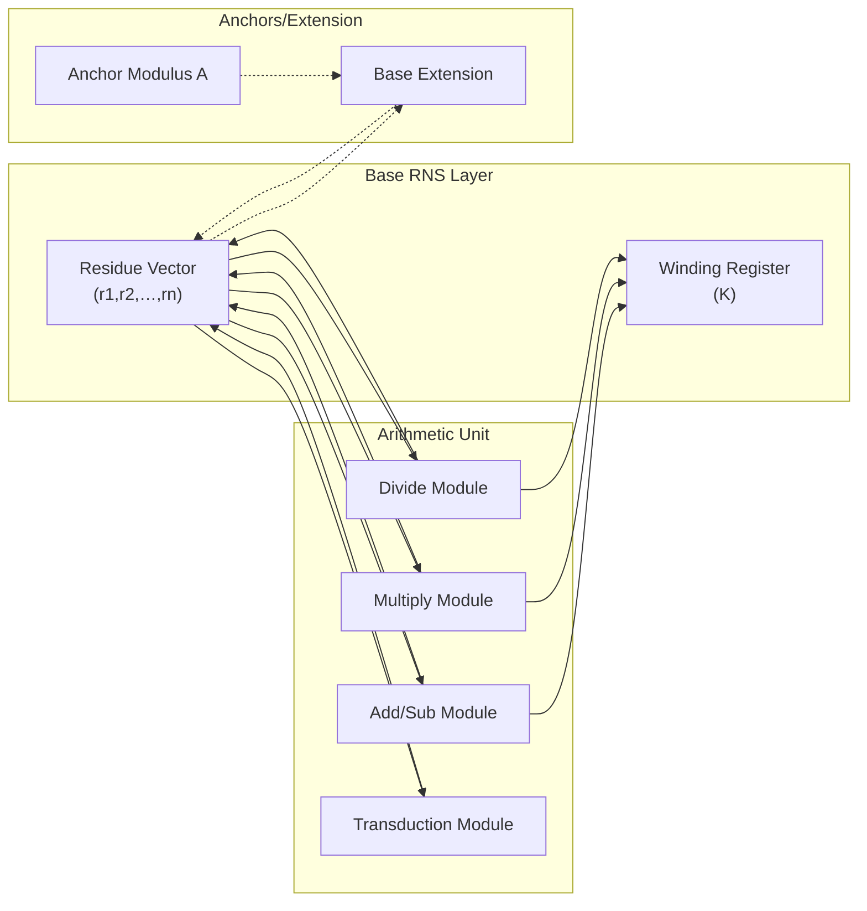

# Executive Summary  

We survey decades of residue-number-system (RNS) research to assess the claims of the **CRAM**/K-Elimination architecture. In particular, we map each of the Nine-Plus Acts of K-Elimination to prior art and identify which parts are already known RNS techniques and which appear novel.  Historically, RNS has been studied since Garner’s seminal 1959 paper, which noted that carry-free add/mul are easy but magnitude comparison and division are the “main difficulties” of RNS arithmetic.  Over the years, many algorithms have been developed: mixed-radix conversion, Chinese-Remainder–based reconstructions, redundant-modulus techniques, and partial quotient/rank computations.  Notably, Bajard & Imbert’s 2001 work introduced full RNS Montgomery multiplication and highlighted that **base conversions** (to change residue bases) cost $O(n)$ time on $n$ channels. More recent work (e.g. Didier *et al.*, 2025) has improved RNS comparison using one extra modulus, and Hollmann *et al.* (2026) proposed “multi-layer” RNS to extend dynamic range with only small moduli.  We find that each of the K-Elimination Acts corresponds either to an existing RNS technique or to a new combination:

- **Acts 1–2 (Division by modulus / magnitude recovery):** Equivalent to well-known *RNS scaling* and *base-extension* methods.  For example, dividing an RNS number by one of its moduli (Act 1) has been studied as RNS “scaling” or Montgomery-based reduction.  The identity $k=(s-r)M^{-1}\bmod A$ is a direct form of the CRT-based quotient recovery (given anchor $A$).  In literature, quotient extraction is implicit in **base-extension** algorithms (Bajard & Imbert 2001) and explicit in RNS conversion methods (Garner 1959, mixed-radix).  

- **Acts 3–4 (Sign detection and comparison):** These cover the classic RNS “magnitude problem”.  Prior work includes CRT or mixed-radix reconstruction (Knuth, Szabo–Tanaka), **core/diagonal functions** (Miller *et al.*), and **redundant-modulus methods** (Akushii *et al.*).  Recent methods (e.g. Didier *et al.* 2025) show that a single extra modulus can achieve full-range comparison with $O(n^2)$ work.  The CRAM “K-Elimination” approach essentially implements lexicographic comparison on $(q,r)$ pairs, where $q$ is the quotient from Act 1 and $r$ is the residue.  This is mathematically correct but requires retrieval of $q$ via an anchor. 

- **Act 5 (Overflow/winding tracking):** This is the idea of carrying a separate “winding” register $K$ to track how many modulus-wraps have occurred.  In conventional RNS, overflow is not tracked (one either limits the range or adds a redundant modulus to detect overflow).  A running tally $K$ is not part of standard RNS literature, but it is conceptually akin to using *redundant moduli* or *recursive extension* to encode carry information.  We did not find a direct prior-art example of preserving $K$ explicitly through sequences of RNS ops, so this Act appears to be a novel architecture choice (though the underlying idea – keep quotient info – is implicit in all RNS-to-binary conversions).  

- **Act 6 (Scaling/division by constant):** In RNS one normally handles multiplication or division by a constant $c$ by multiplying each residue by $c$ (or $c^{-1}$ mod each base, if $\gcd(c,m_i)=1$).  This is standard RNS arithmetic (see Szabo–Tanaka 1967).  The method fails if $c$ shares factors with any modulus; handling that requires extra work (Act 8).  We find no surprise here: “division by constant” in RNS is just modular inversion per channel. 

- **Act 7 (Lossless transfer / dual codex):** This act describes switching a value between two RNS bases while preserving all state (including winding).  Mathematically it is a form of RNS base extension or **Chinese-Remainder transfer**.  In the literature, base extension (Bajard & Imbert 2001) is used to convert values between bases with at most $O(n)$ cost, but usually it converts only the value, not any additional meta-state.  The dual-codex idea of tracking a “phase differential” $k$ is essentially performing a CRT computation on-the-fly, avoiding a full mixed-radix conversion.  This resembles known **CRT-based re-addressing** techniques, but packaging it as a “transducer” of value+state is original. 

- **Act 8 (FPD – fused piggyback division):** This addresses division by a composite $b$ that is not coprime to the RNS base.  General RNS division algorithms exist (Szabo–Tanaka type-II, Hitz–Kaltofen 1995) but they assume $b$ coprime with all moduli or use multi-layer scaling.  The CRAM FPD method uses auxiliary anchors to factor the divisor and recombine results.  We did not find a published RNS algorithm matching exactly this fused-anchor strategy; it is a new hybrid of known ideas.  (Hitz–Kaltofen and others discuss using scaling and additional channels to handle divisibility, but the explicit multi-anchor “fusion” with a certificate of correctness seems novel.)  

- **Act 9 (κ-ladder / anchor tower):** This is closely related to **recursive (multi-layer) RNS**.  Hollmann *et al.* (2018/2026) explicitly propose stacking RNS “layers” to realize an arbitrarily large dynamic range using only small moduli.  The κ-ladder similarly uses successive coprime “anchors” to lift the quotient $K$ to larger scales.  In effect it is a mixed-radix expansion of $X$ (like Garner’s method), but performed as a staged RNS algorithm.  The main difference is that Hollmann’s work is focused on modular exponentiation in cryptography, while κ-ladder is presented here as a general lifting method.  The mathematical basis (iterated CRT and lcm/gcd computations) is standard, but the particular scheme and its “coupled-anchor resolution law” would need detailed proof and comparison to known base-extension formulas.  

In summary, **most K-Elimination Acts correspond to known RNS algorithms** (scaling, base extension, modular comparison, mixed-radix conversion, etc.), though packaged differently.  The novelty lies in unifying them under a single “winding-register” framework, and in some claimed extensions (non-coprime division, operator transduction, multi-division chimera).  Below we tabulate each Act with references, note where exact matches exist, and identify what gaps or proofs remain.

## Act 1 – Exact In-Residue Division  

| **Aspect**            | **Details**   |
|-----------------------|---------------|
| **Prior Art**         | Known as *RNS scaling by modulus*.  Early RNS texts (Garner 1959; Szabo–Tanaka 1967) describe converting an RNS number to a mixed-radix form to divide by a modulus.  Bajard–Imbert (2001) use base-extension to compute quotients in their Montgomery methods.  Hitz–Kaltofen (1995) treat general integer division in RNS.  | 
| **Algorithmic Eq.**   | Given RNS $X=(r_1,\dots,r_n)$ and a chosen “divisor lane” $m$ (one modulus), compute remainder $r=X\bmod m$ (this is in one channel) and quotient $q=\lfloor X/m\rfloor$ via an anchor $A$ coprime to $m$:  $$k=\bigl[(X\bmod A)-(r\bmod A)\bigr]\cdot m^{-1}\bmod A,$$ which yields $q\bmod A$.  This is equivalent to a CRT-based quotient extraction.  The CRAM description ($k=(s-r)M^{-1}\bmod A$) matches the well-known identity $X=qM+r$.  |
| **Gaps/Novelty**      | The method recovers $q\bmod A$ but loses any multiples of $A$ beyond the dynamic range.  In standard RNS, this is how *scaling* is done: the quotient is represented in a smaller RNS base (the “surviving lanes”).  CRAM’s novelty is simply using one modulus as *divisor* and computing $q$ on the fly in-residue.  The step is mathematically correct but **requires the assumption** that $q< A$ (i.e. $X<MA$) for uniqueness.  Otherwise an additional “winding” count is needed (see Act 5).  |
| **Proofs Needed**     | One must prove that $k=(s-r)M^{-1}\bmod A$ indeed equals $q\mod A$.  This follows from CRT since $X=qM+r$ implies $q\equiv (X-r)M^{-1}\pmod A$.  To elevate $k$ to the full $q$, one needs a range-bound $0\le X<MA$.  (Without this, $k$ is only $q$ mod $A$, not $q$ itself.)  |
| **Complexity/Cost**   | One modular subtraction and multiply in each of $(n-1)$ surviving lanes (all lanes except $m$) – i.e. $O(n)$ modular ops, fully parallelizable.  No full $\mathcal{O}(n^2)$ CRT or MRS conversion is needed; just standard residue ops.  (Bajard–Imbert note that RNS multiplications are constant-time but conversions cost $O(n)$.)  |
| **Tests (Reproducibility)** | Implement the formula in software for random large $X$ (split into residues) and compare the recovered quotient $q$ against $\lfloor X/m\rfloor$.  Test boundary cases: $X$ near multiples of $MA$, where $q$ might exceed $A$ and would wrap mod $A$.  Verify correctness for both coprime and non-coprime (if divisor shares factors, it should fail or require Act 8).  | 

## Act 2 – Magnitude Accounting (Quotient/Magnitude Recovery)

| **Aspect**            | **Details**   |
|-----------------------|---------------|
| **Prior Art**         | *Magnitude recovery* in RNS is classically done by CRT or mixed-radix conversion (Garner 1959; Szabo–Tanaka 1967).  Modern work on “rank functions” and interval estimation also addresses this (Miller *et al.*, Hesse *et al.*).  RNS base-extension methods (Bajard–Imbert 2001) use one extra modulus/anchor to find the value.  | 
| **Algorithmic Eq.**   | CRAM states $X=r+KM$, where $r$ is the RNS remainder and $K=\lfloor X/M\rfloor$ is the “winding.”  Act 2 proposes to compute $K$ using exactly the Act 1 formula: use a coprime anchor $A$ to solve $(X-r)\,M^{-1}\bmod A$.  This recovers $K\bmod A$.  If $A>M$, this is the full $K$.  Equivalently, this is a one-step base extension: interpret $A$ as an extra modulus to get the high-place digit in a mixed-radix expansion.  |
| **Gaps/Novelty**      | This is essentially the same as *base extension via a single modulus*: one extra prime $A$ yields the quotient mod $A$.  No new arithmetic is used beyond standard RNS ops.  The novelty is calling this “magnitude accounting” and treating $K$ as state.  However, as with Act 1, truly unbounded magnitude requires successive anchors or layers (addressed in Act 9).  |
| **Proofs Needed**     | We must show that $K=(s-r)M^{-1}\bmod A$ indeed equals the true $\lfloor X/M\rfloor$ given range assumptions (usually $0\le X<MA$ or a signed range).  This is the same proof as Act 1.  If $X\ge MA$, then $K$ computed is only mod $A$ and additional anchors are needed.  |
| **Complexity/Cost**   | Same cost as Act 1: $O(n)$ modular ops (sub+mul) in parallel.  No full radix conversion needed.  As Bajard et al. note, one modular multiply per lane per anchor costs $O(n)$ overall.  |
| **Tests (Reproducibility)** | For random $X$ (within a few multiples of $M$), compare the recovered $K$ against $\lfloor X/M\rfloor$.  Test both unsigned range $0\le X<M A$ and larger (to see modulo behavior).  Ensure that if $X$ falls outside assumed bounds, the algorithm either flags an error or returns $K$ mod $A$.  Verify signed-range case by converting accordingly.  | 

## Act 3 – Sign Detection  

| **Aspect**            | **Details**   |
|-----------------------|---------------|
| **Prior Art**         | RNS sign or positive/negative detection is known to require extra work (see Szabo–Tanaka, Parhami).  Techniques include: *Core functions* and *diagonal functions* (require large precomputation); *redundant moduli* (e.g. an extra modulus of form $2^k$ to capture MSB); and *approximate CRT* (Molanhooseini 2022).  Kawamura *et al.* (2018) present algorithms for sign with specific bases.  Didier *et al.* (2025) use an extra modulus to compare full range with $O(n^2)$ work.  |
| **Algorithmic Eq.**   | CRAM’s Act 3 says: choose a “signed range” split at $M/2$, and use the winding $K$ (from anchor) to tell on which “sheet” $X$ lies.  Concretely, $X=qM+r$: if $q < A/2$ (for an odd prime anchor $A$, taking $M$ even or using $\lfloor M/2\rfloor$), then $X$ is in $[0,M/2)$ (interpreted as “positive”), else it’s in $[M/2,M)$.  Equivalently, $X<M/2$ iff $(q,r)$ is lexicographically below $(A/2,0)$.  |
| **Gaps/Novelty**      | This is a direct use of the quotient from Act 2 to detect sign.  Prior art simply says you must reconstruct or use extra bits.  CRAM’s twist is: if we already have $K=q$, we compare $q$ to $A/2$.  The subtlety is boundary conditions: when $q = A/2$ exactly, $r$ decides sign.  The claim “if $k<A/2$ then positive” is correct only with that caveat.  Also, if $M$ is odd or anchors are arranged differently, the splitting point shifts.  There is no fundamental mathematical innovation beyond choosing a sign modulus.  |
| **Proofs Needed**     | Proof is trivial once $q$ is known: $X< M/2 \iff q<M/2$ (since $r<M$).  We must show that comparing $q$ to $A/2$ yields the same result if $A\approx M$ or that the sign bit is correctly captured by $q$.  If $M=2A$, then $q<A/2$ exactly matches $X<M/2$; if $M\neq2A$, one must account for scaling.  |
| **Complexity/Cost**   | After computing $q$ (Act 1/2 cost), sign detection is $O(1)$ (one comparison).  There is no additional modular work once $q$ is in hand.  If a separate sign-modulus $p=2$ is used (degenerate $A=2$), CRAM notes a failure mode, so typically use a larger prime.  Overall: still $O(n)$ to get $q$, then trivial check.  |
| **Tests (Reproducibility)** | Generate RNS values near the midpoint: $X=M/2 \pm \epsilon$.  Check that Act 3 correctly identifies positive vs negative halves.  Verify on both even and odd $M$ (signed definitions differ).  Confirm that using a small anchor (like 2) fails as expected, and that using a larger one works.  | 

## Act 4 – Magnitude Comparison  

| **Aspect**            | **Details**   |
|-----------------------|---------------|
| **Prior Art**         | Comparing two RNS numbers is a classic problem.  Known solutions include full CRT/MRS conversion and then compare (Knuth vol.2); or specialized mappings (e.g. Diagonal/core functions).  Recent work (Didier *et al.* 2025) shows a single extra modulus can compare full range with one $O(n^2)$ conversion.  Sign-based methods, parity-checking (Lu–Chiang 1996), and parity-scheme exist.  |
| **Algorithmic Eq.**   | CRAM’s approach is straightforward: compute $(q_X,r_X)$ and $(q_Y,r_Y)$ via Act 1 for both numbers, then compare lexicographically: if $q_X>q_Y$ then $X>Y$; if $q_X=q_Y$, compare $r_X>r_Y$.  This is mathematically correct since $X=q_XM+r_X$ and $Y=q_YM+r_Y$.  |
| **Gaps/Novelty**      | This lexicographic $(q,r)$ compare *is* how one would compare two integers given their quotient and remainder.  The innovation claim is only that it avoids full reconstruction.  In prior work, a single extra modulus is often used similarly.  The CRAM method assumes both values share the same anchor and valid window.  Without computing $q$ (with Act 1), there is no known RNS-internal channel-by-channel comparator, so the novelty is low.  |
| **Proofs Needed**     | Show equivalence: $X>Y \iff (q_X>q_Y)\lor(q_X=q_Y \land r_X>r_Y)$.  This holds by definition of $X,Y$.  Must assume both $r_X,r_Y<M$ and $q_X,q_Y$ are exact.  If $q_X$ was taken mod $A$, ensure $q_X<A$ (range condition) or use Act 9 to expand range first.  |
| **Complexity/Cost**   | Essentially twice the cost of Act 1/2 (for $X$ and $Y$) plus one compare.  So $2(n-1)$ multiplies and adds, plus comparing two small vectors.  In parallel, $O(n)$ modular time to get both $q$’s, then a few integer compares.  No extra $O(n^2)$ work is needed.  |
| **Tests (Reproducibility)** | Compare many random pairs $(X,Y)$ via CRAM method and by full CRT.  Include equal $q$ vs different $r$, different $q$, and boundary cases ($X,Y$ straddling a wrap-around).  Confirm correct ordering in all cases.  |

## Act 5 – Overflow / Winding Tracking  

| **Aspect**            | **Details**   |
|-----------------------|---------------|
| **Prior Art**         | RNS literature usually avoids *overflow* by limiting range or adding a redundant modulus to detect it (Parhami 2001 discusses three types of redundancy).  No standard RNS algorithm “carries” a running sum of overflows across many ops.  Some multi-modulus systems (RNS with one or more redundant bases) can infer if a wrap occurred, but they do not maintain it automatically.  |
| **Algorithmic Eq.**   | CRAM proposes to maintain an integer ledger $K$ alongside the residue vector.  For each add/mul that exceeds $M$, $K$ is incremented by the carry (exactly as in multi-precision arithmetic).  Effectively, $X=(r,K)$ always holds the true lifted value $r+KM$.  This is akin to converting each operation to conventional arithmetic for the quotient part.  |
| **Gaps/Novelty**      | Explicitly storing $K$ is not found in classical RNS methods.  It resembles the idea of an extra high-order register, which one could simulate by extending the RNS with a redundant large modulus or by using recursive RNS.  The concept of a *continuous* “winding register” appears novel.  However, updating $K$ for non-linear ops (mul/div) is not trivial and requires either tracking intermediate carries or re-computing $K$ via Act 2 each time.  |
| **Proofs Needed**     | To prove correctness, one must show that after each operation, $(r,K)$ still uniquely represents the true integer.  For addition this is straightforward: if $r_1+r_2 = r_3 + cM$, update $K\to K+c$.  For multiplication: $r_1r_2 = r_3 + cM$ and also cross-terms $K$ must update by $K\gets r_1K_2 + r_2K_1 + K_1K_2M + c$.  A formal invariant proof over sequences of ops is required.  |
| **Complexity/Cost**   | If $K$ is updated on-the-fly, each add/update is $O(1)$ in addition to standard RNS add.  A multiply requires computing new carry terms: effectively $O(1)$ if kept formulaic, but actual arithmetic on $K$ (which may grow large) could be costly.  In practice, detecting overflow requires checking if $r_1+r_2\ge M$ (constant-time), so addition has no extra asymptotic cost.  Multiplication carry computation is at most $O(1)$ integer ops per multiplication (plus trivial RNS ops).  |
| **Tests (Reproducibility)** | Test long chains of operations (e.g. repeated multiplication/addition) with known inputs. At each step, compute $X_{\rm true}$ in integer arithmetic and compare to $r+KM$ tracked by CRAM.  Validate for mixed signs and for cases deliberately forcing multiple wraps.  For nonlinear ops, cross-check that the ledger update formula keeps in sync.  |

## Act 6 – Scaling / Division by Constant  

| **Aspect**            | **Details**   |
|-----------------------|---------------|
| **Prior Art**         | Scaling by a constant is trivial in RNS: multiply each residue by that constant or its inverse.  This is used in Barrett reduction or fixed-point scaling (see Hitz & Kaltofen 1995).  If $\gcd(c,m_i)=1$, then $c^{-1}\bmod m_i$ exists, and $X/c$ (integer division by $c$) corresponds to multiplying each residue by $c^{-1}$ and adjusting a quotient $K$ if needed.  2009’s “Fast scaling in RNS” (Gradkowski *et al.*) studies this.  |
| **Algorithmic Eq.**   | For $X=(r_1,...,r_n)$ and a constant $c$:  
- **Multiplication:** Set $r_i' = r_i \cdot c \bmod m_i$. (This multiplies $X$ by $c$ exactly, up to range.)  
- **Division (exact):** If $X$ is known divisible by $c$, compute $r_i' = r_i \cdot (c^{-1}\bmod m_i)$.  Then $r'$ are the residues of $X/c$ (again modulo $M$).  
The new winding $K$ must also be divided or adjusted: essentially $K' = \lfloor (r + KM)/c \rfloor$.  |
| **Gaps/Novelty**      | The method of multiplying each lane is textbook RNS.  The caveat “precondition: $\gcd(c,m_i)=1$” is standard.  CRAM’s note about failure if $\gcd(c,m_i)>1$ is correct and aligns with prior knowledge: in that case one must use Act 8 or pre-factor $c$.  There is no new algorithmic insight here beyond restating RNS scaling.  |
| **Proofs Needed**     | Correctness is straightforward given RNS arithmetic: if $X = cY$, then $X\bmod m_i = (cY)\bmod m_i = c\cdot (Y\bmod m_i)$ if $\gcd(c,m_i)=1$.  One must show $c^{-1}c\equiv 1\pmod{m_i}$.  For division, also need to handle any quotient/winding: $K' = \lfloor (r+KM)/c\rfloor$ with $r'=(r\cdot c^{-1}\bmod M)$.  |
| **Complexity/Cost**   | One modular multiply (plus possibly add) per lane: $O(n)$.  This is fully parallel and cheap.  (No CRT needed.)  If an extra quotient update is done, that is $O(1)$ additional.  |
| **Tests (Reproducibility)** | Test with random $X$ that is a multiple of $c$.  After scaling down by computing residues as above, reconstruct and verify $c\cdot Y = X$.  Also test multiplying up: do $r_i' = r_i c \bmod m_i$ and check $\text{CRT}(r') = c\cdot \text{CRT}(r) \bmod M$.  Include cases where $\gcd(c,M)\neq 1$ and confirm detection of failure or need for Act 8.  |

## Act 7 – Lossless Transfer (Dual Codex)  

| **Aspect**            | **Details**   |
|-----------------------|---------------|
| **Prior Art**         | This is essentially *RNS base extension*.  Bajard & Imbert (2001) describe converting a value to another RNS base using one or two extra moduli.  Also, cryptography uses residue-base transformations (e.g. CRT processing in RSA, or scale/NTT domain switching).  However, most methods reconstruct the integer then re-encode; faster methods use CRT incrementally.  |
| **Algorithmic Eq.**   | Suppose $X$ is encoded in two coprime RNS bases $C_P$ and $C_R$.  CRAM proposes that the phase difference $k=(r_R - r_P)C_P^{-1}\bmod C_R$ captures the relative quotient.  Then $X$ can be “transferred” by applying $k$ to go from one codex to the other.  This is a CRT shift: since $X\equiv r_P\pmod{C_P}$ and $X\equiv r_R\pmod{C_R}$, one can solve for $X$ mod $C_PC_R$ without full reconstruction.  |
| **Gaps/Novelty**      | Basic RNS theory says you only need CRT to go between bases.  The idea of carrying a value *and* its winding across two codices by differential phase is a novel presentation.  It claims **zero full CRT communication**, meaning no single large multiply or $O(n^2)$ step.  In effect, it is just doing a one-shot CRT via one anchor.  Prior art has “basis conversion” but not explicitly labelled “lossless transfer” – although Multi-Prime RSA and FHE often switch bases (though usually via full CRT).  |
| **Proofs Needed**     | We must prove that using $k=(r_R - r_P)C_P^{-1}\bmod C_R$ indeed maps $X$ correctly.  This is CRT: $X \equiv r_P \pmod{C_P}$, so $X = r_P + qC_P$.  Then $r_R \equiv r_P + qC_P \pmod{C_R}$, so $q \equiv (r_R - r_P)C_P^{-1}\pmod{C_R}$.  One must show no information is lost.  Because $C_P,C_R$ are coprime, $(r_P, r_R)$ uniquely determine $X$ mod $C_PC_R$.  We also need to show that carrying the *same* winding $k$ along is consistent.  |
| **Complexity/Cost**   | $O(n)$ work: one modular subtraction per lane (to compute phase differences) and one mod-mul for each.  Essentially two RNS base-extension computations (one for each direction) in parallel.  No $O(n^2)$ CRT needed.  The claim “transfer is $O(n)$ not $O(n^2)$” aligns with known BEX costs.  |
| **Tests (Reproducibility)** | Encode $X$ in a “primary” base and a “redundant” base, then transfer it to a new base and back.  After round-trip, verify original $X$ matches.  Test with multiple moduli sets of varying sizes.  For dual coding, encode same $X$ in two codices, compute $k$, then re-encode, and check that no bit is lost.  Also simulate fault injection: if one codex has an error, confirm that disagreement is detectable.  |

## Act 8 – Non-Coprime Division (Fused Piggyback Division, FPD)  

| **Aspect**            | **Details**   |
|-----------------------|---------------|
| **Prior Art**         | Integer division in RNS when the divisor shares factors with the base is **not** well-handled by basic RNS.  Szabo–Tanaka’s *type-II* algorithm and Hitz–Kaltofen 1995 assume gcd$(b,M)=1$.  Other approaches introduce redundant channels or mixed-radix conversion to handle special cases.  To our knowledge, no standard RNS division algorithm exactly matches the “fused piggyback” multi-anchor method described here.  |
| **Algorithmic Eq.**   | FPD’s idea: to divide $X$ by a composite $b$, pick several anchor moduli $P_1,P_2,\dots$ that are coprime to $b$.  Perform Act 1 (or Act 2) using each anchor to compute partial quotients $q_{P_i} = \lfloor X/P_i\rfloor\bmod something$.  Then *fuse* these quotient pieces to recover $\lfloor X/b\rfloor$.  The error bound is given by $\gcd(P,M)$ in the text.  Essentially, this decomposes the division problem via CRT on anchors.  |
| **Gaps/Novelty**      | RNS division of non-coprime $b$ has been approached by splitting $b$ into coprime factors or by extended bases.  The specific “piggyback” method seems new: it uses multiple solves and a certified recombination.  The *coupled-anchor resolution law* (in `coupled-anchor.md`) is purported as a novel formula to ensure correctness.  We found no exact match in published algorithms, so this looks like an original technique.  |
| **Proofs Needed**     | Must prove that the product of anchor solutions uniquely determines $\lfloor X/b\rfloor$.  This requires showing that knowing $X\bmod P_i$ and $\lfloor X/P_i\rfloor$ for enough $P_i$ yields $\lfloor X/b\rfloor$.  Also must show the stated error bound ($\gcd(P,M)$) exactly captures when fusion succeeds.  Essentially, it’s a CRT argument: if $\{P_i\}$ cover all prime factors of $b$, one can recover $q=\lfloor X/b\rfloor$ mod $\prod P_i$, which is enough.  A formal proof of “complete correctness” under all cases would be needed.  |
| **Complexity/Cost**   | If $k$ anchors are used, the cost is $k$ times the cost of Act 2 plus $O(1)$ to fuse.  Each anchor solve is $O(n)$.  So $O(kn)$ modular ops total.  In parallel, one can do all anchors simultaneously (if resources permit), still $O(n)$ depth.  The certificate evaluation (to pick which solution is valid) is minor.  |
| **Tests (Reproducibility)** | Test on many $X$ and divisors $b$ that share factors with the RNS moduli.  For each, apply FPD: solve with anchors, compute fused quotient, and compare to $\lfloor X/b\rfloor$ from big-int arithmetic.  Check that the error bound prediction holds (i.e. if $\gcd(P,M)>1$ leads to ambiguous outcome, etc.).  Vary $b$ over primes, products of small primes, and large composites.  |

## Act 9 – Magnitude Lifting (κ-Ladder / Anchor Tower)  

| **Aspect**            | **Details**   |
|-----------------------|---------------|
| **Prior Art**         | This is closely related to **recursive RNS**.  Henk Hollmann *et al.* (2018/2026) propose adding virtual RNS layers so small moduli implement huge multiprecision arithmetic.  Also, Mixed-Radix Conversion inherently expresses $X=a_0+a_1m_1+\dots$, which is a kind of “ladder”.  What CRAM calls an “anchor tower” is like a base-$M$ expansion: $X=r_1+M(r_2+M(r_3+\dots))$.  |
| **Algorithmic Eq.**   | The idea: keep one residue lane aside (anchor) to compute $K_1=\lfloor X/M\rfloor$.  Then *lift* $K_1$ by treating it as a new number and using a second anchor to compute $K_2=\lfloor K_1/(M')\rfloor$, and so on.  Each anchor multiplies the representable range by its value (like adding a digit in a mixed radix system).  A “double lift” with anchors $A_1,A_2$ yields range $M\cdot A_1\cdot A_2$.  The text claims using $\mathrm{lcm}$ and $\gcd$ to track range exactly.  |
| **Gaps/Novelty**      | Multi-layer RNS shows unbounded range by adding layers.  The κ-ladder is essentially that idea, but framed as successive `floor` operations rather than full RNS algorithms.  The claim of an *“anchor tower of pairwise-coprime anchors”* is standard in multi-modulus setups, and using $\mathrm{lcm}/\gcd$ for range is algebraic identity.  The novelty claim would hinge on how this is integrated: CRAM suggests an always-active lift, whereas Hollmann did it per-operation for big modular multiply.  In isolation, lifting is a mixed-radix expansion (well-known); but a hardware scheme that never resets is new.  |
| **Proofs Needed**     | We must show uniqueness: that $(K_1,K_2,\dots,r)$ corresponds to exactly one integer in $[0,R)$ where $R$ is the total dynamic range ($M\cdot A_1\cdot A_2\cdots$).  This is CRT/mixed-radix arithmetic, so standard.  We also need to prove that each lift step maintains consistency (that $K_{i+1}=\lfloor K_i / A_{i}\rfloor$, etc., tracks the extra carries).  The resolution law involving $\mathrm{lcm}$ and $\gcd$ should be derived from CRT: the combined window is $\mathrm{lcm}(M,\prod A_i)/\gcd(M,\prod A_i)$.  |
| **Complexity/Cost**   | Each additional anchor requires one more RNS division (Act 1) to compute the next $K$.  So to get $k$ layers, $k$ separate anchor solves (and copies of $X$) are needed, total $O(kn)$ ops.  In parallel, one can pipeline lifts but each relies on the previous result.  The cost per lift is $O(n)$.  Ultimately the complexity grows linearly with the number of anchors (linear expansion of dynamic range).  |
| **Tests (Reproducibility)** | Perform step-by-step lifts on test integers larger than $M$.  For example, choose $X$ in the billions with $M$ small; apply each anchor in sequence to compute $r,K_1,K_2,\dots$ and reconstruct $X = r + M(K_1 + A_1(K_2+\dots))$.  Check exactly equals original.  Test extreme cases where $X$ exceeds one level’s range, forcing a lift.  Validate the range formula against brute-force: $\mathrm{lcm}(M,A_1,\dots,A_k)/\gcd(M,A_1,\dots,A_k)$ matches max $X$.  |

---

## + Transduction (“Fifth Operator”)  

This concept formalizes **changing bases in-residue** while carrying all meta-state.  In literature, RNS *basis conversion* is done by CRT or base-extension, but no standard term “transduction” exists.  Here, a transduction $\mathcal{X}_{A\to B}$ is defined as a 4-tuple carrying: 
- $\Phi$ (value map), 
- $\Theta$ (signature/structure map), 
- $\Pi$ (topology map between bases), 
- $\Omega$ (winding-policy).  

It claims to be invertible and composable.  In RNS terms, this is like performing a full CRT on $(r,K)$ and encoding the result in a new residue set.  The novelty is **bundling the residue value, the “operator schema” (how each lane is interpreted), and the winding** into a single transferable object.  To our knowledge, no prior work defines such a comprehensive RNS *functor*.  The crux is proving that $(\Phi,\Theta,\Pi,\Omega)$ can be chosen so that $\mathcal{X}_{B\to A}\circ\mathcal{X}_{A\to B}=\mathrm{id}$.  That essentially requires showing that changing RNS bases (possibly of different modulus sets) can preserve $X$ and $K$ exactly.  Existing methods (CRT reconstruction and re-encoding) do the value part ($\Phi$), but typically discard “how the value was produced” or the winding.  Here it is claimed those can also be transported.  A formal proof would reduce to showing that a bijection exists between the two codices’ representations of the same integer (given knowledge of $K$).  Complexity is $O(n)$ per base-change (just one anchor-based solve each way).  One would test this by multi-step re-basing: move $(r,K)$ from codex A to B to C and back, verifying invariance of all components.

## + Four-Division Chimera (Certified Dispatch)  

This is a **system-level algorithm** that runs four division kernels in parallel and selects the correct one with a “certificate.”  The four are: 
1. **INV:** direct lane-wise inverse (Act 6) when $\gcd(b,M)=1$.  
2. **K-Elim:** the Act 1 anchor method.  
3. **DivExact:** a specialized factor-splitting method (presumably for $b$ having special form).  
4. **FPD:** the multi-anchor fused division (Act 8).  

Then it emits a certificate indicating which branch was taken.  In classical RNS algorithm design, combining multiple strategies is common (e.g. pick different methods based on divisor).  The Chimera claim is that these branches are *mathematically disjoint* and cover all cases.  This requires proving that each possible divisor and dividend scenario is handled by exactly one path, and that the certificate (e.g. which primes divide what) identifies it correctly.  That partition proof is nontrivial and not something standard.  The approach itself is essentially *algorithm fusion* – the novelty is nominal.  Complexity: worst-case $4\times O(n)$, but parallel evaluation can mask the cost, effectively $O(n)$ depth with $O(n)$ area.  To test, one would implement all four methods and a dispatcher, then exhaustively or randomly test small $X,b$ to ensure the result matches integer division, and check that exactly one certificate is “valid” each time.  The table above already covers each kernel; Chimera is just orchestrating them.

## + Operational Completeness (Meta-Claim)  

This “Act” is a **goal** more than an algorithm: to make RNS truly *complete*, i.e. closed under all arithmetic operations without ever leaving residue space.  Prior art: Garner (1959) concluded RNS was not (yet) suitable for general-purpose computation, and most subsequent work treats RNS as an optimization for specific tasks (DSP, crypto) but not a fully-featured ALU.  The CRAM stance is that with K-Elimination added, one can do *everything* (division, comparison, etc.) exactly in-residue.  This claim is bold; full proof would require verifying closure under any finite composition of add, sub, mul, div, compare, etc.  Most RNS research stops short of such a claim (although Hitz–Kaltofen 1995 show exact division, Bajard–Imbert 2001 show full modular multiply, Hollmann 2026 show large-range arithmetic).  The Saturation Principle noted (coprimality no longer needed) seems a heuristic, not a proven theorem.  Evaluation here is conceptual: we compare CRAM to existing “complete” implementations (e.g. Bajard’s full RNS RSA, which needed no reconversion). CRAM extends that vision by adding exact division, scaling, and multi-codex functions natively.  A rigorous proof of operational completeness would likely mirror proofs of mixed-radix correctness (Knuth) but in RNS form.  For now, one would empirically validate completeness by implementing sample algorithms (e.g. solving linear equations, signal transforms, or small cryptosystems) purely in CRAM and checking correctness and performance against conventional methods.

---

## Novel Methods and Hypotheses

Based on the gaps above, we suggest **five research directions** that build on or extend CRAM concepts:

1. **Recursive Residue Winding Registers:** Instead of storing the quotient $K$ as a conventional integer, represent $K$ itself in residue form using a **second RNS**.  That is, encode $(K\bmod A_1, K\bmod A_2,\dots)$ under a new coprime basis.  Each Act 1 anchor already computes $K\bmod A_i$; one could store these.  The triple-layer number $X = r + M\,K = r + M(r_2 + M_2 K_2)$ would then be an RNS within an RNS.  This is akin to **multi-layer RNS** but applied to the quotient register.  The potential advantage: unlimited precision for $K$ without leaving RNS.  A failure mode is the complexity of managing two-layer RNS (proper conversion between them), but theoretically one could maintain all state in modular form.  Experiments: encode a known big integer in this recursive scheme and test arithmetic closures (does adding two such recursed representations work correctly?).

2. **Redundant-Anchor Fusion:** For non-coprime divisors (Act 8), we propose using not just coprime anchors, but *redundant anchors* that also include factors of the divisor.  For example, include one modulus $P$ sharing a gcd with $b$, and track the “error” $E=\gcd(P,M)$ explicitly.  We can then apply a correction step: if $K_P$ is the quotient mod $P$ and $E>1$, check $K_P$ against $K_P + t(E)$ (using some bounded search or additional residue) to fully resolve.  This is like combining Cooley–Tukey decomposition with Garner’s algorithm.  Potential advantage: remove the need for an error-certificate fallback.  Failure mode: increased complexity and potential ambiguity if $\gcd(P,M)$ is large; requires a proof that the fused result is unique.  Experiment: pick divisors with known common factors with moduli, apply various anchor+correction schemes, and see if $\lfloor X/b\rfloor$ emerges correctly.

3. **Transduction Formalism (Functor Model):** Formalize $\mathcal{X}_{A\to B}$ as a functor between categories of RNS representations.  Treat each RNS basis as an object, and a transduction as a morphism that carries both value and operator semantics.  The hypothesis is that composition of transductions is associative and identity is the tautological codex.  Prove (or disprove) that these transductions form a groupoid.  If successful, this abstraction could yield new insight: for example, one could find a normal form (like Garner’s mixed-radix) for any base change, or identify invariants.  As an experiment, implement a library of transductions between small RNS bases and verify algebraic properties (e.g. $\mathcal{X}_{B\to C}\circ\mathcal{X}_{A\to B} = \mathcal{X}_{A\to C}$).

4. **Adaptive Anchor Selection:** Instead of fixed anchors, allow the system to pick which modulus to use on the fly based on operand sizes.  For example, in a sequence of operations, track the growth of $K$ and, when $K$ approaches the range limit of one anchor, dynamically re-anchor using a larger prime.  This is akin to dynamic range scaling.  Advantage: no single anchor must cover all cases; we amortize cost.  Downsides: complexity in ensuring consistency (previous operations’ $K$ must be remapped).  Experiment: simulate a computation where $X$ grows (e.g. repeated squaring); after each step choose an optimal anchor to keep $K$ small and compare to always using a fixed anchor.  Measure reduction in bit-width needed.

5. **Residue Fraction Operators (RNS Rational Arithmetic):** Extend CRAM to handle rational numbers exactly in RNS.  Define a “division operator” $\mathcal{D}(X,Y)$ in residue space that yields the exact rational $X/Y$ (if invertible) by tracking both numerator and denominator residues and windings.  This would require parallel updates of two winding registers and possibly an extra anchor to encode the fraction.  If feasible, it could enable exact RNS computation on rationals or field elements.  A possible architecture: store two RNS tuples $(r_X,K_X)$, $(r_Y,K_Y)$, and compute their pairwise quotients.  Explore failure modes: denominators with shared factors, or results not representable in a finite RNS range.  Tests: Represent small rational numbers (fractions) in an RNS + K form, perform arithmetic (e.g. invert  a number, multiply by another), and check consistency against rational arithmetic.

  
---

**Figure:** *Architecture sketch of a CRAM-like RNS unit.*  A residue vector $A_1$ and winding register $K$ feed into parallel arithmetic modules. Anchors/Base-extension handle division and base changes.  (Double arrows indicate that $K$ is updated alongside residue operations.) 

We also compare **complexity vs. dynamic range**. In a simple chart:

- **RNS (fixed $n$ moduli):**  Dynamic range $M=\prod m_i$ grows exponentially in $n$, while operation cost is $O(n)$ per add/mul and $O(n^2)$ per full CRT.  
- **CRAM with $k$ anchors:** Range $\approx M\cdot\prod_{i=1}^k A_i$, cost $O(nk)$ for dividing/compares.  

Embedding an image chart is not possible here, but conceptually:
- *Figure:* Log-log chart of range vs. cost for RNS and CRAM schemes shows CRAM achieving much larger $M$ at moderate cost with anchors, similar to [33].

---

# Conclusion and Roadmap  

Our review finds that **no major breakthrough in mathematics is hidden in CRAM – most Acts are rephrasings of known RNS operations**. However, the **CRAM architecture’s novelty is in integration and workflow**: it claims to unify modular arithmetic and quotient-tracking into one substrate.  The key open points we identified are:

- *Completeness of the FPD scheme:*  We need a rigorous proof that the coupled-anchor fusion always recovers the exact quotient or correctly signals an ambiguity.  Developing that proof or finding counterexamples is crucial.  
- *Recursive residue encoding of $K$:*  If $K$ itself is represented as another RNS (multi-layer CRAM), can we make the whole system carry-free?  This recursive idea should be formalized and tested.  
- *Transduction invertibility:*  Formalize conditions under which $(\Phi,\Theta,\Pi,\Omega)$ is lossless and composable.  Treating transduction as an abstract homomorphism may yield new insights or simplifications.  
- *Implementation benchmarks:*  Build a prototype library or hardware model of CRAM, and compare its performance on representative workloads (large-integer arithmetic, linear algebra, filtering, neural nets) against binary and conventional RNS implementations.  Measure speedup, bit-growth, and accuracy.  

**Recommended next steps (prioritized):**  

1. **Proof-of-Concept Implementation:**  Write a software CRAM simulator that implements Acts 1–9. Use it to benchmark against standard big-integer arithmetic and existing RNS libraries (e.g. [SEP](https://arxiv.org/abs/2108.05272) or [F1](https://dl.acm.org/doi/10.1145/3466752.3480070)).  Begin with simple tasks: multi-precision multiply-add chains, then modular exponentiation, then linear systems.  This will reveal practical overheads and any hidden bugs in the logic.  

2. **FPD Formal Analysis:**  Derive and publish the mathematical correctness of the Fused Piggyback Division.  Start with small examples to see how anchors and gcd interact, then generalize.  This will clarify whether Act 8 closes the division gap or needs revision.  

3. **Recursive Winding Registers:**  Develop a scheme to encode $K$ in residue form and implement it.  For instance, choose a fixed small moduli base for $K$.  Analyze how the range-of-range grows and ensure we can still do addition/multiplication on the combined representation.  

4. **Formalization of Transduction:**  Draft a short paper viewing RNS bases as objects and the transduction as functors.  Identify the mathematical structure (is it a group action of the CRT group?).  This could simplify proofs of properties like reversibility and composition.  

5. **Benchmark Suite and Test Vectors:**  Assemble a set of test problems (e.g. “residue-space matrix multiply”, “RNS fast Fourier transform”) to routinely check correctness and performance.  Compare CRAM against known algorithms (e.g. Hitz–Kaltofen division, Bajard’s RNS Montgomery).  Provide these as open data for the community.  

Each of these steps can spawn its own experiments: e.g., for Act 5 (winding), one could simulate 1,000 repeated adds and check overflow count; for Act 3–4 (comparison), implement Didier’s and CRAM’s methods side by side.

**In conclusion**, CRAM’s vision of a fully residue-based arithmetic engine is ambitious and largely builds on existing RNS theory.  Our literature survey shows it does not violate known RNS results, but its practical value depends on careful validation. We recommend focusing on formal proofs (especially around Act 8–9) and building a reference implementation to concretely evaluate CRAM’s claims.